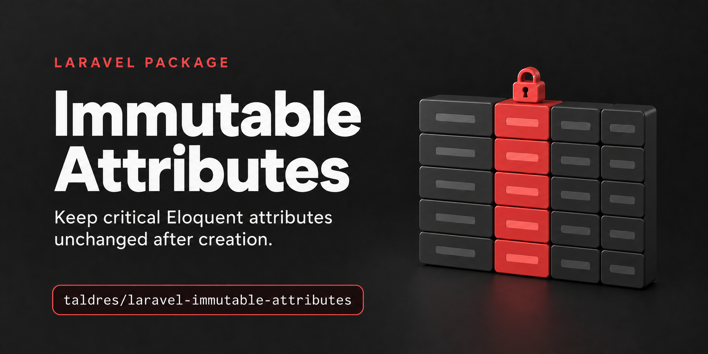

# Laravel Immutable Attributes

> **Columns that are set once and never change: declare them on the Eloquent model, and every save that would alter them throws.**

[](https://packagist.org/packages/taldres/laravel-immutable-attributes)


```php
#[Immutable('number', 'customer_id', 'issued_at')]
class Invoice extends Model
{
    use GuardsImmutableAttributes;
}

$invoice->number = 'INV-999';
$invoice->save(); // ImmutableAttributeException, nothing is written
```

## Why this package?

Some values must stay what they were when the row was written: an invoice
number that is already on a sent PDF, the owner of an order, the text a person
consented to. When code changes one of them by mistake, nothing fails. The row
looks normal, and the damage shows up much later.

- **`$guarded` does not help.** It only stops mass assignment; `$invoice->number = ...` still goes through
- **One declaration instead of a listener per model.** The usual fix, an `updating` listener that checks `isDirty()`, ends up copied into every model that needs it
- **Covers the paths a listener misses.** Saves and increments without events (`saveQuietly()`, `incrementQuietly()`, `withoutEvents()`) and changes made by a later `updating` listener or observer are caught too
- **Inserts are untouched.** The attributes are set freely until the row exists
- **Saving the same value is not a change.** A save is checked with Eloquent's own dirty tracking, casts included. An increment is checked by the columns its query writes, because that query bypasses casts
- **Eloquent queries on request.** Add `GuardsImmutableQueries` and `Invoice::whereKey($id)->update([...])`, `upsert()` and the other builder writes are checked too; `DB::table()` stays open for corrections

## Requirements

- PHP 8.3+
- Laravel 13.3 or later

Laravel 12 is supported by version 1, which receives fixes on the `1.x` branch:
`composer require taldres/laravel-immutable-attributes:^1.0`.

## Installation

```bash
composer require taldres/laravel-immutable-attributes
```

There is nothing to publish or configure.

## Usage

Add the trait and list the immutable attributes with `#[Immutable]`:

```php
use Illuminate\Database\Eloquent\Model;
use Taldres\ImmutableAttributes\Attributes\Immutable;
use Taldres\ImmutableAttributes\Concerns\GuardsImmutableAttributes;

#[Immutable('number', 'customer_id', 'issued_at')]
class Invoice extends Model
{
    use GuardsImmutableAttributes;
}
```

`#[Immutable(['number', 'customer_id'])]` works as well, and so does the named
argument `columns:`. Any other name is rejected, because
`#[Immutable('number', except: ['note'])]` would otherwise guard `note` too, the
opposite of what `except` means on `#[ImmutableModel]`.

A declaration needs at least one column and does not take `'*'`, empty names,
names with whitespace around them (a non-breaking or zero-width space counts),
non-strings or JSON paths such as
`'options->currency'`; the guard compares whole columns, so guard `'options'`
instead. A model declared that way fails when it boots with an
`InvalidImmutableColumnsException` that names the class carrying the attribute.

### The whole model

`#[ImmutableModel]` guards every attribute: once a row exists it is never
updated again, not even by `touch()` or `restore()`. Deleting stays possible.
That suits tables whose rows are only ever added, such as logs or ledgers:

```php
use Taldres\ImmutableAttributes\Attributes\ImmutableModel;

#[ImmutableModel]
class LedgerEntry extends Model
{
    use GuardsImmutableAttributes;
}
```

It takes no columns. Passing one, as in `#[ImmutableModel('number')]`, would
guard more than meant, so it fails when the model boots with an
`InvalidImmutableColumnsException`; use `#[Immutable('number')]` instead.

#### Leaving columns out

Name the columns that may still change with the named argument `except`, the
way `$fillable` lets columns through a guarded `*`. Every other column, and every
column you add to the table later, stays guarded:

```php
#[ImmutableModel(except: ['views', 'updated_at'])]
class Article extends Model
{
    use GuardsImmutableAttributes;
}

$article->increment('views'); // allowed
$article->update(['title' => 'New title']); // ImmutableAttributeException
```

`except` is a named argument on purpose: a positional `#[ImmutableModel('views')]`
would read as "guard everything but `views`", the opposite of what
`#[Immutable('views')]` means, so it is rejected.

Every save and every increment also writes `updated_at`. Leave it out as well,
as above, or the counter throws; `Model::withoutTimestamps()` is the other way
out. A column that `#[Immutable]` names stays guarded even if `except` lists it.

### Inheritance and presets

Declarations stack: `#[Immutable]` and `#[ImmutableModel]` on a parent model, on
the model itself, and on any trait they use are merged, so a child model can add
attributes but never release one. With several `#[ImmutableModel]`, only the
columns that all of them leave out stay mutable, and one without `except` leaves
out nothing.

Both attributes can be extended for a named preset. The subclass needs its own
`#[Attribute]` marker:

```php
use Attribute;
use Taldres\ImmutableAttributes\Attributes\ImmutableModel;

#[Attribute(Attribute::TARGET_CLASS)]
class Ledger extends ImmutableModel
{
    //
}
```

A preset can fix its `except` by calling `parent::__construct(except: ['memo'])`
in its own constructor.

### Deciding at runtime

Override `getImmutableAttributes()` and return the guarded attributes, or `['*']`
for all of them, as Laravel's `getGuarded()` does. Base the decision on the
stored state with `getOriginal()`, not on unsaved attributes; otherwise the save
that finalizes the row is already checked against the stricter list and throws:

```php
public function getImmutableAttributes(): array
{
    return $this->getOriginal('finalized_at') !== null ? ['*'] : ['number'];
}
```

With `['*']`, `getMutableAttributes()` lists what stays mutable, the same list
`except` fills. Override it as well to decide that at runtime; an attribute that
`getImmutableAttributes()` names is guarded all the same.

The list must hold column names as non-empty strings without whitespace around
them. Anything else throws an
`InvalidImmutableColumnsException` naming the model, the first time the list is
used.

`getOriginal()` is the state this model instance loaded, not the row as it is now.
Two limits follow:

- A query that leaves `finalized_at` out of its `select()` makes `getOriginal()`
  return `null`, so the model counts as not finalized.
- If another process finalizes the row after the model was loaded, this instance
  still treats it as open and saves. `refresh()` narrows the window but does not
  close it. Where finalization must be binding, load the row inside a
  transaction with `lockForUpdate()` and save before the transaction ends.

### The exception

A violation throws `Taldres\ImmutableAttributes\Exceptions\ImmutableAttributeException`,
a `RuntimeException`, before the update query runs:

```php
try {
    $invoice->update(['number' => 'INV-999', 'paid' => true]);
} catch (ImmutableAttributeException $e) {
    $e->model;      // App\Models\Invoice
    $e->key;        // 42
    $e->attributes; // ['number']
}
```

The model keeps its unsaved changes; call `$invoice->refresh()` to discard them.
Until then every save of that model throws, including an `increment()` of
another column.

### What is guarded

| Guarded | Not guarded |
| --- | --- |
| `save()`, `update()`, `push()` | Eloquent builder writes: `Invoice::whereKey($id)->update([...])`, `upsert()`, unless the model [guards its queries](#guarding-eloquent-queries) |
| `fill()` and `forceFill()` followed by a save | `increment()` and `decrement()` on a model that does not exist yet, which Laravel runs as a query on the whole table, unless the model guards its queries |
| `saveQuietly()`, `updateQuietly()` and saves inside `Model::withoutEvents()` | Deleting and soft deleting |
| Changes made by `updating` listeners and observers | Parent timestamps touched through `$touches`, unless the parent guards its queries |
| `increment()` and `decrement()`, including the extra columns and the update timestamp they write; an immutable extra column throws even with its current value | |
| `incrementQuietly()` and `decrementQuietly()`, and `increment()` and `decrement()` inside `Model::withoutEvents()` | `DB::table()`, `toBase()` and raw queries |
| `incrementEach()` and `decrementEach()`, and on Laravel 13.20 and later their `Quietly` variants | |
| `touch()` when the touched column is immutable, such as `updated_at` under `#[ImmutableModel]` | |
| `restore()` when `deleted_at` is immutable, such as under `#[ImmutableModel]` | |

Without `GuardsImmutableQueries`, the Eloquent builder stays open on purpose:
it is the escape hatch for deliberate corrections, data migrations and erasure.
With it, `DB::table()` takes that role.

An attribute that was not selected, as with `select('id', 'paid')`, counts as
changed once you set it, even to the stored value.

The check for saves without events lives in `getDirtyForUpdate()`. If the model
overrides that method, PHP uses the model's method instead of the trait's, and
`parent::getDirtyForUpdate()` skips the trait, so the check is gone. Alias the
trait method and call it instead:

```php
use GuardsImmutableAttributes {
    getDirtyForUpdate as protected guardedDirtyForUpdate;
}

protected function getDirtyForUpdate(): array
{
    $dirty = $this->guardedDirtyForUpdate();

    // Your own adjustments.

    return $dirty;
}
```

The same applies to `incrementOrDecrement()` and `incrementOrDecrementEach()`:
the trait overrides them to check the columns an increment writes, before the
increment runs and whether or not it fires events, so a model that defines them
needs the same aliasing and the trait's return type, `int|false`. A rejected
increment leaves the model as it was.

A key counts as the column it writes, whatever its qualifier: `invoices.number`
counts as `number`, and `options->currency` counts as `options`. Entries
returned by `getImmutableAttributes()` are matched the same way, so
`'options->currency'` there guards the whole `options` column. The exception
names the attribute as declared.

Databases disagree on whether `NUMBER` and `number` are the same column, so the
guard leans towards throwing. An immutable attribute matches in any case:
`NUMBER` counts as `number` on every database. A column left out with `except`
or `getMutableAttributes()` only counts under its exact name, so with
`except: ['views']` a write to `VIEWS` throws. Name it in the case your code
writes it.

An increment by `0` of an immutable column throws as well. Its query still
writes the column, and the database turns the value into a number, so `001` in
a text column becomes `1`.

### Guarding Eloquent queries

`GuardsImmutableAttributes` checks what a model saves. Writes through the
Eloquent builder never load a model, so it does not see them. Add
`GuardsImmutableQueries` to check those too:

```php
use Taldres\ImmutableAttributes\Concerns\GuardsImmutableAttributes;
use Taldres\ImmutableAttributes\Concerns\GuardsImmutableQueries;

#[Immutable('number')]
class Invoice extends Model
{
    use GuardsImmutableAttributes;
    use GuardsImmutableQueries;
}

Invoice::whereKey($id)->update(['number' => 'INV-999']); // ImmutableAttributeException, nothing is written
Invoice::whereKey($id)->update(['paid' => true]);        // allowed
```

The trait needs `GuardsImmutableAttributes`, on the model or a parent; without
it PHP refuses the class. The model's declarations, `except` and the rules for
column names apply unchanged.

The two traits check different things:

- **The model compares.** A save throws only when an immutable attribute
  changed; saving the stored value passes.
- **The builder forbids.** A query throws as soon as it writes an immutable
  column, whatever the value, because it does not load the rows it writes. The
  check runs no query of its own, and the exception's `key` is `null`.

The builder checks these writes:

- `update()`, including the update timestamp the Eloquent builder adds to it
- `increment()`, `decrement()`, `incrementEach()` and `decrementEach()`, with
  their extra columns and, where the Eloquent builder writes it, the update
  timestamp; an amount of `0` counts as a write
- `upsert()`: new rows may set immutable columns, the columns updated on a
  conflict may not. Without its third argument, `upsert()` updates every column
  it is given, so pass the columns to update. The update timestamp counts, even
  with an empty list
- `updateOrInsert()` when the row exists; Laravel's own existence query runs
  first, an insert may set immutable columns
- `touch()` and `updateFrom()`
- the same calls on a relation, such as `$customer->invoices()->update([...])`,
  and on a collection's `toQuery()`

A key counts as the column it writes, as for the model: `invoices.number` is
`number`, and `options->currency` is `options`. A qualifier is not compared
with the table, so a table alias such as `i.number` counts as well. On MySQL and
MariaDB, an update over a join may write a column of the joined table; when
that column shares its name with an immutable column, as `ledger_entries.number`
would, the builder rejects it too. Write it through the joined model's query
instead.

Inserts and deletes pass. A soft delete passes as well, from the model or from
the builder, as long as the update writes nothing but a deletion timestamp and
the update timestamp. When one of them is immutable, the soft delete reaches
only rows that are not deleted yet, whatever else the query selects, so a
deletion timestamp that is set stays as it is. Restoring through the builder throws when `deleted_at` is immutable,
as `restore()` on the model does.

Writes through `DB::table()`, `Invoice::query()->toBase()`, `getQuery()` and
raw SQL are not checked; they are the escape hatch for deliberate corrections. A raw expression
in place of a column name, as in the update list of `upsert()`, is not
inspected either.

Some writes that the model guard leaves alone run through the builder, so the
builder now checks them:

- `increment()` and `decrement()` on a model that does not exist yet, which
  Laravel runs on the whole table
- a relation that touches this model when the update timestamp is immutable,
  such as a child's `$touches` or a `belongsToMany()` relation that touches.
  The child is saved before the exception, so wrap the save in a transaction,
  leave `updated_at` out of the guard, or use `Model::withoutTouchingOn()`

The model's own saves and increments pass through the builder as well. The
model guard has checked them by then, so they behave as before, with one
exception: a save in the same second as the stored update timestamp leaves
`updated_at` unchanged on the model, but the builder still writes it. With
`updated_at` immutable, that save now throws, as every later save already did.

The builder has no row to look at. An override of `getImmutableAttributes()`
that depends on the stored state, such as `getOriginal('finalized_at')`, is
asked on a new, empty model and returns the list for a row that is not
finalized. That holds for a query that starts from a loaded model as well, such
as a collection's `toQuery()`.

#### Custom builders

`GuardsImmutableQueries` puts `Taldres\ImmutableAttributes\Builders\ImmutableBuilder`
in place of Laravel's builder. A builder the model names itself, with the static
`$builder` property, `#[UseEloquentBuilder]` or Laravel's `HasBuilder`, stays in
place, but it has to guard its writes. Extend `ImmutableBuilder`:

```php
use Taldres\ImmutableAttributes\Builders\ImmutableBuilder;

class InvoiceBuilder extends ImmutableBuilder
{
    public function unpaid(): static
    {
        return $this->where('paid', false);
    }
}

class Invoice extends Model
{
    use GuardsImmutableAttributes;
    use GuardsImmutableQueries;

    protected static string $builder = InvoiceBuilder::class;
}
```

A builder that extends another base, such as one from a package, uses the trait
instead:

```php
use Taldres\ImmutableAttributes\Concerns\GuardsImmutableWrites;

class InvoiceBuilder extends SomePackageBuilder
{
    use GuardsImmutableWrites;
}
```

A builder without either is not replaced: the first query throws a
`LogicException` that names it. A model that defines its own
`newEloquentBuilder()` throws one when it boots, because that method would
replace the one that picks the builder; name the builder with `$builder`
instead. With `HasBuilder`, both traits define `newEloquentBuilder()`, so pick
this package's:

```php
use HasBuilder, GuardsImmutableQueries {
    GuardsImmutableQueries::newEloquentBuilder insteadof HasBuilder;
}
```

The builder checks only models that use `GuardsImmutableQueries`. A builder
shared with models without it writes for them as before.

A builder that overrides `update()`, `upsert()`, `touch()`, `increment()`,
`decrement()`, `incrementEach()`, `decrementEach()`, `updateOrInsert()` or
`updateFrom()` replaces the trait's method. Alias the trait method and call it,
as for `getDirtyForUpdate()` above, and keep its return type:

```php
use GuardsImmutableWrites {
    update as guardedUpdate;
}

public function update(array $values): int
{
    // Your own adjustments.

    return $this->guardedUpdate($values);
}
```

Larastan reads the builder from the model's `newEloquentBuilder()`, which is now
the trait's, so it sees Laravel's builder. `HasBuilder` keeps `Invoice::query()`
typed with your own.

## AI agents

The package ships a [Laravel Boost](https://github.com/laravel/boost) skill,
`laravel-immutable-attributes-development`. Run `php artisan boost:install` and
select `taldres/laravel-immutable-attributes` among the third-party packages. A
non-interactive install only picks up packages listed under `packages` in
`boost.json`.

## Development

Built on the [Laravel package skeleton](https://github.com/laravel/package-skeleton):

```bash
composer test       # PHPStan level 10, Pint, type coverage, Pest
composer lint       # Pint
```

See [CONTRIBUTING](.github/CONTRIBUTING.md) and the [changelog](CHANGELOG.md).

## Security Vulnerabilities

Please review [our security policy](.github/SECURITY.md) on how to report security vulnerabilities.

## License

MIT. See [LICENSE.md](LICENSE.md).
